<!-- ================================================================= -->
<!-- SHOBHIT JAIN // AI & MACHINE LEARNING ENGINEER PORTFOLIO -->
<!-- ================================================================= -->

  <!-- 1. HERO SECTION -->
  

    

  <!-- Quick Action Nav Row -->
  

    
    &nbsp;
    
    &nbsp;
    
    &nbsp;
    
    &nbsp;
    
  

  

 

<!-- ================================================================= -->
<!-- 2. ABOUT THE ENGINEER -->
<!-- ================================================================= -->

 

> **`SYSTEM_PROFILE`** : Engineering scalable artificial intelligence and predictive algorithms with high mathematical rigor and low inference latency.

I am a **B.Tech student** and **AI/ML Engineer** dedicated to bridging the divide between theoretical model design and robust, production-ready software systems. My work centers on **Python**, **Machine Learning**, **Deep Learning**, and **high-throughput asynchronous backend APIs**.

Instead of stopping at exploratory Jupyter notebooks, I build complete end-to-end intelligence pipelines: from raw data wrangling, feature engineering, and statistical modeling to containerized deployment and interactive user interfaces. As a **technical creator**, I actively explore emerging AI developments, experiment with novel model architectures, and break down complex engineering concepts into accessible insights.

 

  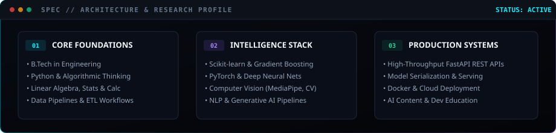

 

  

 

<!-- ================================================================= -->
<!-- 3. CURRENTLY BUILDING -->
<!-- ================================================================= -->

 

  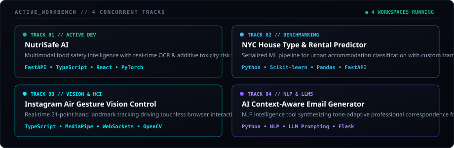

 

| Track | Focus Domain | Key Technologies | Access &amp; Code |
| :--- | :--- | :--- | :--- |
| **01 // NutriSafe AI** | Multimodal food safety, OCR chemical detection &amp; risk inference | `FastAPI` `TypeScript` `React` `PyTorch` | [**View Repository →**](https://github.com/ershobhit17/NutriSafe-AI) |
| **02 // NYC Housing Predictor** | End-to-end urban rental classification &amp; serialized `.pkl` pipeline | `Python` `Scikit-learn` `Pandas` `FastAPI` | [**View Repository →**](https://github.com/ershobhit17/NYC-House-Type-Predictor) |
| **03 // Air Gesture Control** | Real-time 21-point hand landmark tracking &amp; WebSocket browser HCI | `TypeScript` `MediaPipe` `WebSockets` `OpenCV` | [**View Repository →**](https://github.com/ershobhit17/Instagram-Air-Gesture) |
| **04 // Context Email Agent** | NLP generative writing assistant with dynamic prompt pipelines | `Python` `NLP` `LLM Prompting` `Flask` | [**View Repository →**](https://github.com/ershobhit17/Email-Generator) |

 

  

 

<!-- ================================================================= -->
<!-- 4. TECHNICAL STACK & ARSENAL -->
<!-- ================================================================= -->

 

  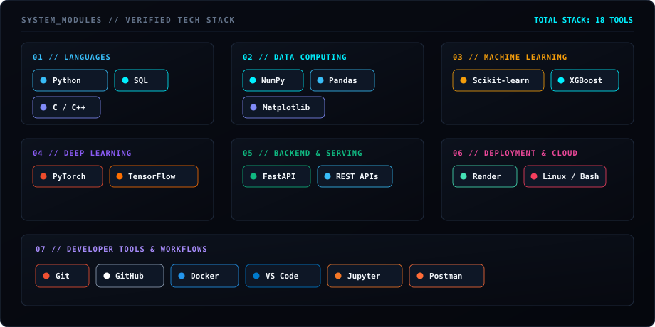

 

| Domain | Verified Technologies &amp; Frameworks |
| :--- | :--- |
| **Languages** | `Python` &nbsp;•&nbsp; `SQL` &nbsp;•&nbsp; `C / C++` |
| **Data &amp; Computing** | `NumPy` &nbsp;•&nbsp; `Pandas` &nbsp;•&nbsp; `Matplotlib` |
| **Machine Learning** | `Scikit-learn` &nbsp;•&nbsp; `XGBoost` &nbsp;•&nbsp; `Feature Transformers` |
| **Deep Learning** | `PyTorch` &nbsp;•&nbsp; `TensorFlow` &nbsp;•&nbsp; `Neural Architectures` |
| **Backend &amp; Serving** | `FastAPI` &nbsp;•&nbsp; `REST APIs` &nbsp;•&nbsp; `Asynchronous Pipelines` |
| **Developer Tools** | `Git` &nbsp;•&nbsp; `GitHub` &nbsp;•&nbsp; `Docker` &nbsp;•&nbsp; `VS Code` &nbsp;•&nbsp; `Jupyter` &nbsp;•&nbsp; `Postman` |
| **Deployment &amp; Cloud** | `Render` &nbsp;•&nbsp; `Linux / Bash Environments` |

 

  

 

<!-- ================================================================= -->
<!-- 5. GITHUB TELEMETRY & ANALYTICS -->
<!-- ================================================================= -->

 

  <!-- Real Dynamic GitHub Stats & Streak Stats -->
  <table border="0" cellpadding="0" cellspacing="0" style="border-collapse: collapse; border: none;">
    <tr>
      <td align="center" valign="middle">
        
      </td>
      <td align="center" valign="middle">
        
      </td>
    </tr>
  </table>

   

  <!-- Top Languages Distribution -->
  

    

  <!-- Verified Contribution Activity Matrix -->
  
<strong><code>&gt; CONTRIBUTION_ACTIVITY_GRAPH // NEON SPECTRUM</code></strong>

  

 

  

 

<!-- ================================================================= -->
<!-- 6. FEATURED PRODUCTION SYSTEMS -->
<!-- ================================================================= -->

 

### 01 // NutriSafe AI — Multimodal Food Safety Intelligence

  <a href="https://github.com/ershobhit17/NutriSafe-AI">
    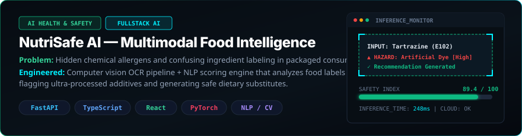
  </a>

- **Problem Statement**: Commercial food packaging deliberately masks ultra-processed additives, carcinogens, and acute allergen risks behind obscure chemical E-numbers.
- **Engineered Solution**: Fullstack intelligence application combining computer vision OCR extraction with an NLP toxicity scoring model. Evaluates ingredients in <300ms, cross-references health hazard databases, and recommends clean nutritional alternatives.
- **Tech Stack**: `FastAPI` • `TypeScript` • `React` • `PyTorch` • `Tailwind CSS` • `Python`
- **Source Code**: [github.com/ershobhit17/NutriSafe-AI](https://github.com/ershobhit17/NutriSafe-AI)

 

### 02 // NYC Housing &amp; Rental Valuation Engine

  <a href="https://github.com/ershobhit17/NYC-House-Type-Predictor">
    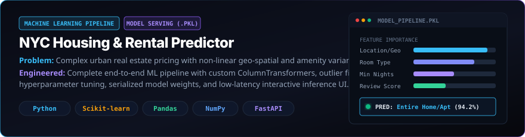
  </a>

- **Problem Statement**: High-density urban accommodations suffer from severe price distortion, spatial clustering bias, and multi-feature non-linear variance.
- **Engineered Solution**: Comprehensive end-to-end Machine Learning pipeline utilizing Scikit-learn preprocessing transformers, categorical encoding, and ensemble classifiers. Serialized as `Model_Pipeline.pkl` with sub-10ms REST API scoring and a reactive frontend.
- **Tech Stack**: `Python` • `Scikit-learn` • `Pandas` • `NumPy` • `FastAPI / Flask` • `HTML5 / CSS3`
- **Source Code**: [github.com/ershobhit17/NYC-House-Type-Predictor](https://github.com/ershobhit17/NYC-House-Type-Predictor)

 

### 03 // Vector-Driven Movie Recommendation Engine

  <a href="https://github.com/ershobhit17/Movie-Recomendation-ML-Project">
    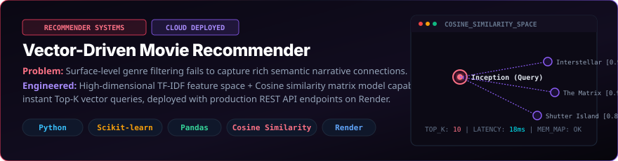
  </a>

- **Problem Statement**: Standard categorical genre sorting fails to identify nuanced semantic and tonal narrative connections across extensive media libraries.
- **Engineered Solution**: High-dimensional vector space recommendation system utilizing TF-IDF feature embeddings and Cosine Similarity matrices to compute real-time Top-K content recommendations, fully deployed on cloud infrastructure.
- **Tech Stack**: `Python` • `Scikit-learn` • `Pandas` • `Cosine Similarity` • `Render` • `REST API`
- **Source Code**: [github.com/ershobhit17/Movie-Recomendation-ML-Project](https://github.com/ershobhit17/Movie-Recomendation-ML-Project)

 

### 04 // Instagram Air Gesture Vision Controller

  <a href="https://github.com/ershobhit17/Instagram-Air-Gesture">
    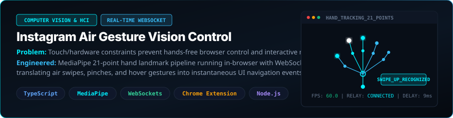
  </a>

- **Problem Statement**: Traditional keyboard and mouse interfaces present accessibility barriers and eliminate hands-free interaction for interactive web streams.
- **Engineered Solution**: Human-Computer Interaction pipeline tracking 21 spatial hand landmarks in browser video feeds. Classifies air gestures (swipes, clicks, pauses) and routes commands through a bidirectional WebSocket relay into web feed actions.
- **Tech Stack**: `TypeScript` • `MediaPipe` • `WebSockets` • `OpenCV` • `Chrome Extension API` • `Node.js`
- **Source Code**: [github.com/ershobhit17/Instagram-Air-Gesture](https://github.com/ershobhit17/Instagram-Air-Gesture)

 

  

 

<!-- ================================================================= -->
<!-- 7. RESEARCH & LEARNING HORIZON -->
<!-- ================================================================= -->

 

  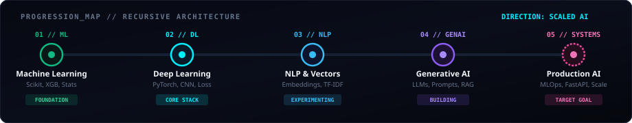

 

My technical trajectory follows an intentional, progressive architecture from algorithmic foundations to high-scale production AI:

1. **Machine Learning Foundations** *(Proficient)*: Statistical inference, Scikit-learn, XGBoost, Cross-Validation, Feature Engineering.
2. **Deep Neural Architectures** *(Core Focus)*: PyTorch, Backpropagation mathematics, CNNs, Activation manifolds, Loss surface optimization.
3. **Natural Language Processing &amp; Vectors** *(Active Expansion)*: Tokenization, Embeddings, TF-IDF, Vector spaces, Cosine distance matching.
4. **Generative AI &amp; Large Language Models** *(Active Building)*: Prompt engineering pipelines, Retrieval-Augmented Generation (RAG), Autonomous agents.
5. **Production AI Systems &amp; MLOps** *(Target Frontier)*: Low-latency FastAPI serving, Model quantization/serialization (ONNX), Containerization, High-throughput inference.

 

  

 

<!-- ================================================================= -->
<!-- 8. INITIATE TRANSMISSION / CONNECT -->
<!-- ================================================================= -->

 

  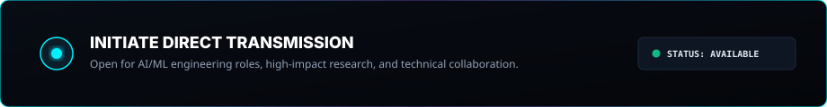

    

  <!-- High-contrast Social Action Grid -->
  

    
    &nbsp;&nbsp;
    
    &nbsp;&nbsp;
    
    &nbsp;&nbsp;
    
    &nbsp;&nbsp;
    
  

 

<!-- ================================================================= -->
<!-- 9. TERMINAL FOOTER -->
<!-- ================================================================= -->

  
  
    
  
  

    Crafted with precision for <strong>Shobhit Jain</strong> // Designed for dark-mode excellence on GitHub.
  

